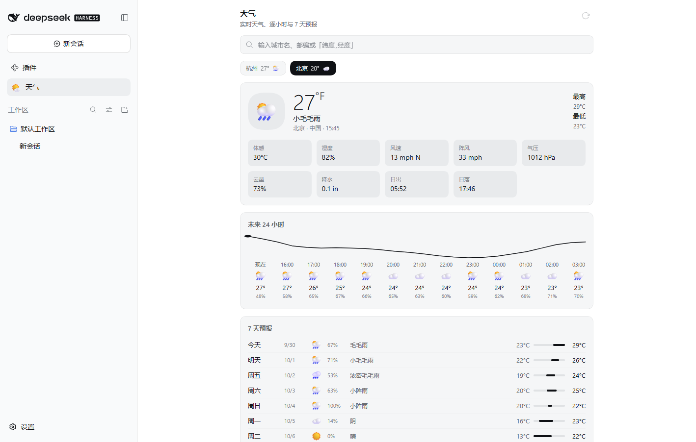

# dsh-plugin-weather

A weather plugin for [DeepSeek Harness](https://github.com/deepseek-ai/deepseek-harness):
a sidebar panel with city management, live conditions, an hourly and 7-day forecast,
and derived life indices — plus a `get_weather` tool the model can call directly.

Data comes from [Open-Meteo](https://open-meteo.com/), which needs **no API key and
no account**, and sends `Access-Control-Allow-Origin: *`, so the browser half talks to
it directly without a proxy.



## What you get

| Surface | Behaviour |
| --- | --- |
| Sidebar entry | A weather row in the left rail, next to the other global panels. |
| Panel | Current conditions, hourly strip with a temperature sparkline, 7-day list with range bars, and life indices. |
| City management | Debounced search by name, postal code, or coordinates; add, switch, and remove saved cities. The list and the unit preference persist per browser. |
| Units | Metric (°C, km/h, mm) or imperial (°F, mph, in). |
| Model tool | `get_weather` returns current conditions plus an hourly and daily projection for a place name or a coordinate pair. |
| Localization | Full Simplified Chinese and English dictionaries, following DSH's active locale. |

## Install

The package is not published to npm; install it from this repository. pnpm accepts a
GitHub shorthand, so the source can stay wherever you keep it:

```sh
# from GitHub
dsh plugin --profile <profile> add github:pxy0971/dsh-plugin-weather

# or from a local checkout
dsh plugin --profile <profile> add /path/to/dsh-plugin-weather
```

Either way, `dsh plugin` records the dependency **and** appends `dsh-plugin-weather` to
that profile's `dsh.profile.bundles`, which is what makes DSH compose it.

Then add the bundle to that profile's `package.json`:

```json
{
  "dsh": {
    "profile": {
      "bundles": ["@deepseek-ai/dsh-base", "@deepseek-ai/dsh-web-app", "dsh-plugin-weather"]
    }
  }
}
```

…or, to keep the activation in the file DSH documents as the user's own layer, leave
`bundles` alone and add one row to the profile's `cordis.patch.yml`:

```yaml
- insert:
    - id: dsh-plugin-weather
      name: dsh-plugin-weather
```

Both routes are one step to undo. Restart DSH afterwards — a newly installed package
is not hot-loadable, though later edits to this plugin are.

### Verify before you restart

```sh
dsh --profile <profile> --dump-config | grep -A1 dsh-plugin-weather
```

The row must appear in the composed tree. A profile whose plugin cannot load will not
boot, so it is worth confirming the composition before cycling the host.

The `desktop` profile is reserved for the Electron application, so the CLI refuses to
read it (`error: profile "desktop" is managed exclusively by the Electron
application`). Verify a change there on a copy instead: create a profile with
`--from-default-profile web`, install the same plugin set, and dump that. A profile
that names a plugin it cannot resolve fails its boot, so check before restarting.

## Configuration

Every field is optional; the defaults are used when the key is absent and when its
value has the wrong type.

```yaml
- id: dsh-plugin-weather
  name: dsh-plugin-weather
  config:
    units: metric          # metric | imperial — the default the panel starts from
    language: zh           # zh | en — language used for place-name search results
    cacheTtlSeconds: 600   # how long a forecast bundle stays fresh on the Host
    cacheLimit: 256        # how many distinct forecast bundles the Host retains
```

`dsh-plugin-weather` reads this object defensively: if the config face is missing or
refuses (for example a hand-edited profile), the plugin still activates with the
defaults above rather than holding the whole boot inactive.

## Architecture

The package ships two halves that DSH composes independently.

```
client/client.js             GENERATED — the shipped browser bundle
src/weather-core.js          one IIFE; publishes its surface onto a caller scope
src/client.template.mjs      browser bundle template, with five build sentinels
src/locale.mjs               the two dictionaries (source of truth)
lib/weather-core-binding.js  Host ESM adapter: installs the core on globalThis
lib/index.js                 Host half: the `weather` service + the `get_weather` tool
lib/locale.js                GENERATED — Host-facing copy of those dictionaries
tools/build-client.mjs       the whole build: substitutions and a JSON dump
tools/test.mjs               offline bench for the core, the bundle, and the panel
tools/test-host.mjs          offline bench for the service, the cache, and the tool
tools/browser-check.mjs      headless-Chrome acceptance run against a live DSH
tools/with-web.mjs           starts a throwaway `dsh web`, hands over url + token
tools/dsh-install.mjs        finds the local DSH installation for the checks above
tools/session-cookie.mjs     mints a session cookie from the persisted secret, so a
                             *running* Host can be interrogated without its launch URL
tools/probe-live.mjs         is the plugin advertised and is its bundle served?
tools/check-inventory.mjs    per-row `fiberPhase`, which Settings does not show
tools/check-server.mjs       bundle route and boot-graph assertions over HTTP
tools/check-manifest.mjs     resolves `exports["./client"]` the way the Host will
```

The bundle is advertised as `"./client"` and lives at `client/client.js`, which is the
layout DSH's client-plugin scanner resolves and the one the shipped ecosystem plugins
use. An **About** row at the bottom of the panel prints the build stamp baked into the
bundle (`package@version` plus the bundle's SHA-256), so which build a browser actually
loaded can be read off the screen instead of inferred.

### One core, two consumers

`src/weather-core.js` holds every WMO code, unit table, request field list, and the
normalization from Open-Meteo's column-oriented payload into row-oriented objects.
Both halves must agree on all of it — a disagreement would make the panel and the
model tool answer differently for the same city — so there is exactly one copy.

The two halves need it in different shapes:

* the **Host half** is ordinary ESM and wants named imports;
* the **browser bundle** is a classic script with no module loader for its siblings,
  so it cannot `import` anything outside DSH's frozen platform table.

The core therefore declares one function, `installWeatherCore(scope)`, and writes its
surface onto the scope it is handed. The Host's adapter calls it with `globalThis`; the
bundler inlines the same file as text and `client/client.js` evaluates it with
`new Function('scope', source)` against a private `{}`. Evaluating the core into a
private object rather than the page's global is what lets two plugins that each inline
their own copy coexist.

### Why there is no bundler

DSH's client module system serves each plugin's `client.js` and executes it as a
classic script that must self-register:

```js
window.__ModuleLoader__.load({ id: 'dsh-plugin-weather', factory: (require) => { /* … */ } })
```

A bundle may only `require` the nine modules DSH seeds into the page before any plugin
runs:

```
react                              react/jsx-runtime
react-dom                          react-dom/client
@deepseek-ai/cordis                @deepseek-ai/dsh-client-store
@deepseek-ai/dsh-client-ui-slots   @deepseek-ai/dsh-client-ui-primitives
@deepseek-ai/dsh-client-ui-dockkit
```

A general-purpose bundler would happily emit a relative `require('./weather-core.js')`,
which that loader cannot resolve — it would fail at panel mount, in the browser, where
it is expensive to diagnose. `tools/build-client.mjs` therefore performs four string
substitutions (package name, version, inlined core, inlined dictionaries) and writes
the bundle directly, with no dependency to install and nothing to keep in sync by hand.

`node tools/test.mjs` fails if a generated artifact drifts from its source, if the
bundle requests a module outside that table, if the inlined core disagrees with the
Host's copy on any WMO code or field list, or if the two locale dictionaries differ by
a single key.

### Build and test

```sh
node tools/build-client.mjs   # regenerate client/client.js and lib/locale.js
node tools/test.mjs           # 27 cases: core, bundle, locale, render, slots
node tools/test-host.mjs      # 22 cases: config, cache, service, model tool
```

No dependencies, no install step: both benches run on the Node they are invoked with.
The Host bench redirects the single `@deepseek-ai/dsh-tools` import to a local stub
through a Node module-resolution hook, so the Host half is exercised without a DSH
installation present.

### Accepted against a real browser

The offline benches prove the logic and the artifact's contract, but not that DSH
actually mounts the panel. `tools/browser-check.mjs` closes that gap: it drives real
headless Chrome over the DevTools Protocol — no Playwright, no npm install — against a
throwaway `dsh web` instance, and asserts the parts a text-only test cannot see.

```sh
# start a disposable profile that mirrors the desktop plugin stack, then check it
node tools/with-web.mjs --profile weathersmoke --port 19411 -- \
  node tools/browser-check.mjs --out docs/panel.png
```

`tools/with-web.mjs` boots the installation's own packaged CLI, because the Desktop
profile can only be started by the Desktop shell. It discovers that installation via
`DSH_INSTALL_DIR`, the checkout's own location, or a short list of conventional paths
(`tools/dsh-install.mjs`); on a machine where none match, it fails with the variable to
set rather than an `ENOENT`. Any Chrome or Edge install is enough for the browser half.

It covers 23 checks: the launch-token exchange and session cookie, the boot graph
naming this plugin, the sidebar entry, the panel mounting with live Open-Meteo data,
the hourly/daily/index sections, the sparkline path, switching city by chip, switching
units to Fahrenheit, the build stamp, and a clean console with no failed resources. The
screenshot at the top of this file is produced by that run.

The smoke profile's plugin stack mirrors the Desktop profile's (`dshmarket`,
`open-sea-skin`, `dsh-plugin-whale-pet`, `@tt-a1i/archify-dsh`) so slot conflicts and
peer-range problems surface before the plugin reaches a real host.

### Accepted against the user's running Host

`tools/browser-check.mjs` boots its own instance, so it cannot see a problem that only
exists in someone's live profile. `tools/probe-live.mjs` covers that case: it mints a
session cookie from the persistent signing secret DSH keeps in `.credentials.yaml`
(`tools/session-cookie.mjs` explains why that is the documented verification path and
not a bypass) and interrogates a *running* Host without its launch URL.

That tool is what finally located the real Desktop bug, in one command:

```
boot graph rows   : 68
weather row       : ABSENT
verdict           : the Host did NOT advertise this plugin as a client module.
```

### Why the Host half imports the tool registry lazily

`@deepseek-ai/dsh-tools` ships **inside** `resources/app.asar`, and the Desktop
installation does not unpack it into `app.asar.unpacked`. An out-of-tree plugin lives
on the ordinary filesystem, and Node's resolution from there can never enter an asar
archive — only Electron itself can.

So for a plugin installed by path, a module-scope

```js
import { defineTool } from '@deepseek-ai/dsh-tools'
```

**fails during activation**, before `apply()` runs. That failure disposes the Host
row's fiber, and DSH only advertises a browser bundle for a row that reached `ACTIVE`
— so the panel vanishes along with the tool. The symptom is a plugin that Settings
lists as installed and enabled while no sidebar entry ever appears, and nothing is
logged that a user would see.

`lib/index.js` therefore publishes the `weather` service synchronously and loads the
tool registry lazily; if that import fails, the failure is recorded on
`service.toolError` and only the model tool is missing. The regression is locked down
by *a missing tool package still activates the panel service* in `tools/test-host.mjs`.

## What you can build with it

The plugin answers when asked; it does not alert, poll, or send anything. Useful
workflows come from combining it with other DSH parts — a standing weather brief via
`@deepseek-ai/dsh-schedule`, or a phone push through a group-robot webhook — and some
obvious combinations are blocked by version gaps rather than by anything missing here.
[docs/workflows.md](docs/workflows.md) records which is which, including why the QQ
Bot channel is currently refused by DSH.

## Notes and limits

* **Forecast horizon** — `get_weather` accepts 1–16 days and defaults to 5; the panel
  always shows 7.
* **Hourly window** — the panel shows the next 24 hours, taken from the location's own
  local clock. Open-Meteo's `timezone=auto` means no viewer-side timezone math.
* **Favourites live in the browser** — the city list and unit preference are stored in
  `localStorage` under `dsh-plugin-weather/v1`, not in the Host. Clearing site data
  resets the panel to Hangzhou and Beijing.
* **One request per favourites refresh** — the chip strip's current temperatures come
  from a single multi-location Open-Meteo call rather than one call per city.
* **Conditions render as glyphs** — DSH's shipped icon set covers UI chrome rather than
  meteorological conditions, so weather codes map to emoji in `src/weather-core.js`.
* **Life indices are derived, not fetched** — UV, precipitation, wind, and daylight
  severity are computed from the daily payload against the thresholds in
  `LIFE_INDEX_DEFINITIONS`; the advice text lives in `lib/locale.mjs`.
* **No offline mode** — a failed request shows an error with a retry; there is no
  bundled fallback forecast.

## License

MIT.
